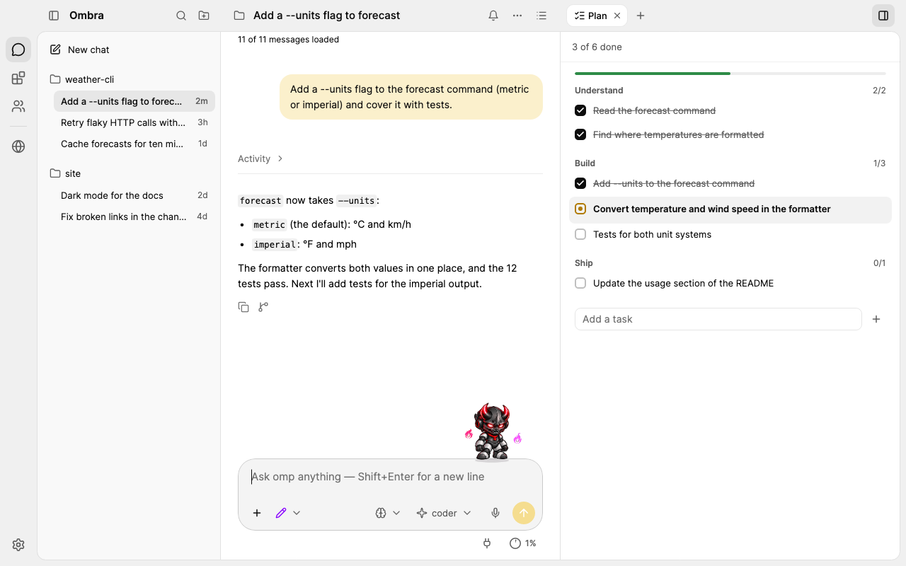

# Ombra

A cross-platform desktop client with an owned coding-agent engine derived from
[oh-my-pi](https://github.com/can1357/oh-my-pi) (`omp`). The beta source tree lives in
[`runtime/engine`](runtime/engine): one app-owned Bun host runs independent logical chat sessions,
connected to the .NET client by multiplexed JSONL RPC. It does not launch an omp CLI process per chat.
Upstream changes are reviewed and integrated into our source, then shipped as a verified immutable engine pack.
See the [next-release roadmap](docs/NEXT_RELEASE_ROADMAP.md) for implementation and verification status.

The client is built with .NET 10 and Avalonia and lives in [`avalonia/`](avalonia). It is an independent project,
not an official product of the omp, Bun, Anthropic or OpenAI projects.

<picture>
  <source media="(prefers-color-scheme: dark)" srcset="avalonia/docs/design/screens/readme-window-dark.png">
  
</picture>

## Install

The current release is for **macOS on Apple silicon** (macOS 14 Sonoma or later): download
`ombra-<version>-osx-arm64.dmg` from the [latest release](https://github.com/samnolak/ombra/releases/latest), open it
and drag *Ombra* to Applications (a `.zip` of the same app is next to it). Ombra is signed with the project's own
certificate, not an Apple Developer ID, and is not notarized, so macOS blocks the first start: open it once, then
*System Settings → Privacy & Security → Open Anyway* ([user guide](avalonia/docs/USER_GUIDE.md#install)).

The app carries its pinned agent engine, so no .NET, Bun or omp installation is needed and the first start works
offline; Settings → Advanced can repair the engine. An ordinary upstream omp CLI is not a compatible GUI engine.
Model providers and API keys live in omp's configuration. The app finds new releases on its own (Settings → Updates)
and installs them when you choose to. The Nightly browser is installed by Ombra on first use, with your consent
(see below).

## What it does

The look and layout follow the ChatGPT desktop app (Codex): neutral grey light and dark themes, one yellow accent
taken from the logo, sentence-case wording. A rail at the window's left edge switches between Chats, Browser and Team.

- **Conversation** — omp's replies as they stream; thinking folded ("Thought for 4s"); every tool call as one line
  (status dot, name, argument) with a result line ("Read 120 lines", "Found 12 files", the first lines of output);
  file changes as inline diffs; "Worked for 12s · 3 tools · 2 files changed" after each run; copy and "Rewind to here"
  on hover; a greeting with starter prompts in a new session. The view follows new output, stays where you scrolled,
  and a ↓ button brings you back.
- **Approvals** — one card for approvals and questions: Allow (1), Deny (2), Deny and say why (3), and "Don't ask
  again" for a command pattern (`bash(npm test:*)`) for this session, this project or always. Rules are listed and
  removed in Settings → Permissions; a request a rule answers shows "Allowed automatically".
- **Composer** — "+" (images, slash commands and skills, connectors, plugins, page comments), `/` and `@` menus,
  long pastes as chips, thinking level, the model with fast mode, extended context, advisor, auto-compact and
  auto-retry, dictation on this computer, Queue and Steer while omp works (queued messages can be removed or pulled
  back with ↑). Under it: the project, the permission mode (Ask permissions / Accept edits / Bypass permissions, its
  colour on the box; Shift+Tab cycles) and the context gauge.
- **Usage** — the context gauge's popover shows the session's tokens and cost and, for signed-in cloud providers,
  their plan limits (5-hour and weekly windows, % used, time to reset); Settings → Model providers shows all of them.
- **Sessions** — every project's sessions in a resizable sidebar, newest message first, with search, pinned
  sessions on top, status dots (working / needs your input / unseen reply) and per-row menus (rename, pin, copy path,
  delete); add and remove projects; Ctrl+Tab cycles. The session title's menu adds compact, hand off, fresh provider
  session, retry, rewind, export, share, workspace folders, move and memory.
- **Panes** — Files (project tree with git marks, a built-in editor with syntax colours, search/replace and Save),
  Plan (omp's todo list and its history), Background tasks (subagents and jobs), a terminal (a shell, or omp's own
  terminal UI) and a browser preview with tabs, device sizes and page comments: mark a point or drag an area, and the
  comments go to omp with the selector, the element and — for React, Vue and Svelte dev builds — the source file.
  omp's browser tool works in that preview: it opens pages, reads them, clicks, types and takes screenshots.
- **Nightly browser** (macOS) — the preview and the **Browser** page can render with Nightly, a full browser (a Zen /
  Firefox build) that Ombra installs in the version it pins, checks by SHA-256 and runs with its own profile. The
  Browser page is a whole Nightly window inside Ombra: tabs, spaces, bookmarks, history, downloads, automatic tab
  groups and a screenshot gallery. Nightly also works on its own as a standalone browser and shares pages, tab
  groups and screenshots with the team through Ombra. The two apps talk only to each other's pinned signature.
- **Team** — your own team on a team server you run: invitations, members and roles, your devices (pairing,
  revoking), safety numbers. Members share links, pages, comments on code and pages, and project progress; what they
  send is end-to-end encrypted, the server only passes it on. Shared items arrive as notifications and in the Inbox
  (Accept / Decline). A git bell watches the project's remote and offers to bring in colleagues' new commits.
- **Pet** — an optional pixel pet that reacts to what omp does; drag it anywhere, click it to send a quick message.
- **Settings** — a full-window page: General, Permissions, Model providers (sign in and sign out, plan usage),
  Connectors (MCP servers, Smithery search), Plugins and skills, Computer use, Git and worktrees, SSH hosts, Pets,
  Updates, Advanced (shared-engine setup and developer command overrides, corporate network certificates, network
  privacy) and Diagnostics. What belongs to omp is changed through omp's own commands and settings.
- **Network privacy** — omp contacts only the model providers you added: on its own, omp asks every provider it
  knows for its model list and probes local model servers, so each time the app starts omp it turns the others off
  for it (omp's `disabledProviders`, passed as a `--config` overlay; your `config.yml` is not changed). Optional
  **strict network privacy** sends omp and the tools it runs through a filter in the app that lets through only the
  added providers, sign-in while you add one, and addresses you allow; everything else is refused and listed. Known
  limitation: omp's background download of its model catalog (`catalog.stencil.so`) has no off switch in omp itself;
  strict mode blocks it ([upstream proposal](avalonia/docs/upstream/omp-discovery-opt-in.md)).
- **Keyboard** — ⌘/Ctrl+/ shows every shortcut.

The [user guide](avalonia/docs/USER_GUIDE.md) describes all of it; [PARITY.md](avalonia/docs/PARITY.md) lists every
omp flag, command and RPC feature with what the client offers for it.

## Platforms and status

Released and checked: **macOS 14+ on Apple silicon** (Ombra and Nightly). The client also builds for macOS Intel,
Windows 11 and Linux (x64 and arm64) — the package workflow can produce those packages — but they are not part of
the current release and are not verified at run time; on them the preview uses the system's web view (WebView2,
WebKitGTK) instead of Nightly. Supported OS versions follow
[.NET 10's list](https://github.com/dotnet/core/blob/main/release-notes/10.0/supported-os.md).

Releases and their update feed are signed with the project's release key, and the app checks that signature before
installing. Ombra and Nightly each accept only the other's signature pinned in the release (cdhash), see
[SECURITY.md](SECURITY.md#ombra--nightly-trust-macos). On macOS the app renders with OpenGL: Avalonia 12.1's Metal
path can show stale, stretched frames while the window resizes
([AvaloniaUI/Avalonia#22215](https://github.com/AvaloniaUI/Avalonia/pull/22215)). Release checks:
[docs/RELEASE_GATES.md](docs/RELEASE_GATES.md); what is verified where: [PROJECT_STATE.md](avalonia/docs/PROJECT_STATE.md).
Linux builds need the distribution's ICU runtime package (`libicu` / `libicuNN`); do not enable .NET
globalization-invariant mode: it disables Unicode normalization
([.NET behavior and dependencies](https://github.com/dotnet/runtime/blob/main/docs/design/features/globalization-invariant-mode.md)).

## Build, run, test

Requires the .NET 10 SDK ([`avalonia/global.json`](avalonia/global.json)). From `avalonia/`:

```
dotnet build Ombra.sln
dotnet run --project src/Ombra.App             # first run offers engine setup; or --config <ombra.local.json>
dotnet test tests/Ombra.Tests                  # real-omp and acceptance tests run only when OMBRA_TEST_CONFIG is set
dotnet build Ombra.sln -c Release && tools/ci/real-omp-smoke.sh <work-dir>
                                                # installs the pinned runtime and runs those tests against a stand-in
                                                # model server (needs Node.js, curl and network access to npm)
tools/real-model/setup.sh <work> <omp-runtime-dir>   # a real small model (SmolLM2 on llama.cpp) for RealModelTests
                                                     # and tools/verify/package-e2e.sh (the packaged app, X11)
```

A self-contained package for one platform, as CI builds it:

```
dotnet publish src/Ombra.App -c Release -r linux-x64 --self-contained -o <publish-dir>
tools/package/package.sh linux-x64 <publish-dir> <out-dir> <version>
```

On a Mac, `tools/package/test-app.sh` builds this checkout as *Ombra Test.app* next to the installed app, with its
own settings folder (copied from the installed app on the first build), for trying changes before a release.

A release is made from a `release/<date>-<version>` branch by running `avalonia-package.yml` with a version,
`platforms: osx-arm64` and `release: published`: it builds and checks the packages, signs `update.json`, publishes the
GitHub release that installed apps update to and fast-forwards `main` to the released commit. Nightly's own release
steps are in [RELEASE_GATES.md › Nightly release build](docs/RELEASE_GATES.md#nightly-release-build).

CI ([`.github/workflows`](.github/workflows)): `avalonia-ci.yml` builds and tests on Linux, Windows and macOS and runs
the real-omp smoke; `avalonia-package.yml` builds and smoke-tests packages (the arm64 Linux and Windows packages are
cross-built only); `avalonia-platform-gates.yml` runs the macOS and Windows gates on demand; `avalonia-speech.yml`
checks dictation with the real speech model.

The workflows run only by hand (*Actions → Run workflow*). Before a merge, run the checks locally and post the
result in the pull request: `dotnet build`
(warnings are errors), `dotnet test tests/Ombra.Tests` (with `OMBRA_TEST_CONFIG` for the real-omp tests), and for
UI changes the layout audit screenshots (`OMBRA_REVIEW_DIR`) and `tools/verify/package-e2e.sh` on a package.

## Repository

| Path | What it is |
|---|---|
| [`avalonia/`](avalonia) | The client: `src/Ombra.Rpc` (process, stdio, framing), `src/Ombra.ClientCore` (state, session control), `src/Ombra.App` (view models, UI, platform adapters), `tests/`, `tools/` (packaging, verification, stand-in model), `packaging/`, `docs/` |
| [`runtime/engine/`](runtime/engine) | Ombra's owned coding-agent engine (derived from omp) |
| [`runtime/packs/`](runtime/packs) | The pinned engine pack (`ombra-engine-18.12.2-bun-1.4.2-v1`: omp 18.12.2 sources on Bun 1.4.2) that the app carries |
| [`runtime/nightly/`](runtime/nightly) | The pinned Nightly runtime (`nightly-runtime.json`) and the script that packs and signs it |
| [`harness/`](harness) | The `harness` omp profile template, used by the client's real-omp tests ([docs/harness.md](docs/harness.md)) |

Documentation for contributors: [PROJECT_STATE.md](avalonia/docs/PROJECT_STATE.md) (state, architecture, decisions,
how to run every environment), [ROADMAP.md](avalonia/docs/ROADMAP.md), [PARITY.md](avalonia/docs/PARITY.md),
[DESIGN_SYSTEM.md](avalonia/docs/design/DESIGN_SYSTEM.md) and [`docs/upstream/`](avalonia/docs/upstream) (proposals
prepared for omp, not applied here).

Work for the next version collects on the [`next`](https://github.com/samnolak/ombra/tree/next) branch; `main` is
always the latest release (a published release moves it there).

## License

MIT — see [LICENSE](LICENSE) and [THIRD-PARTY-NOTICES.md](THIRD-PARTY-NOTICES.md).
