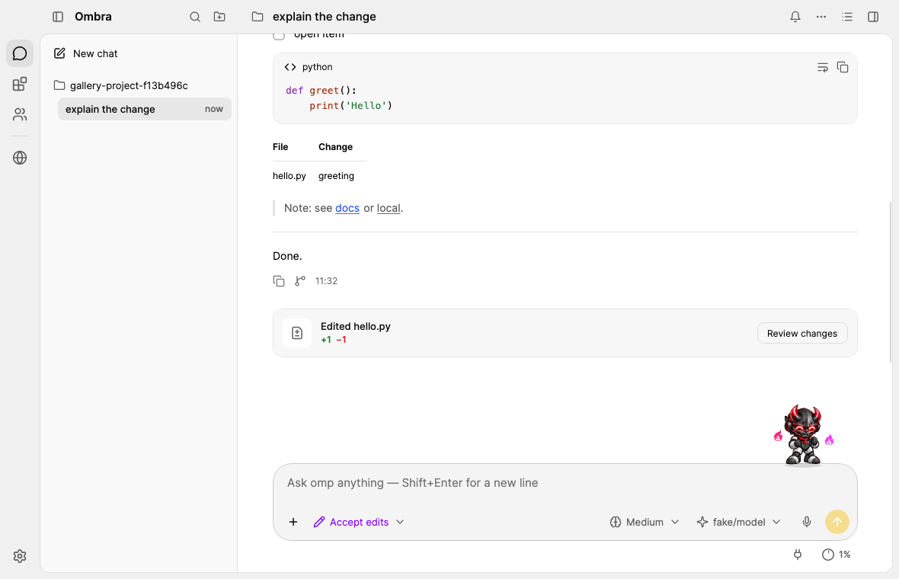
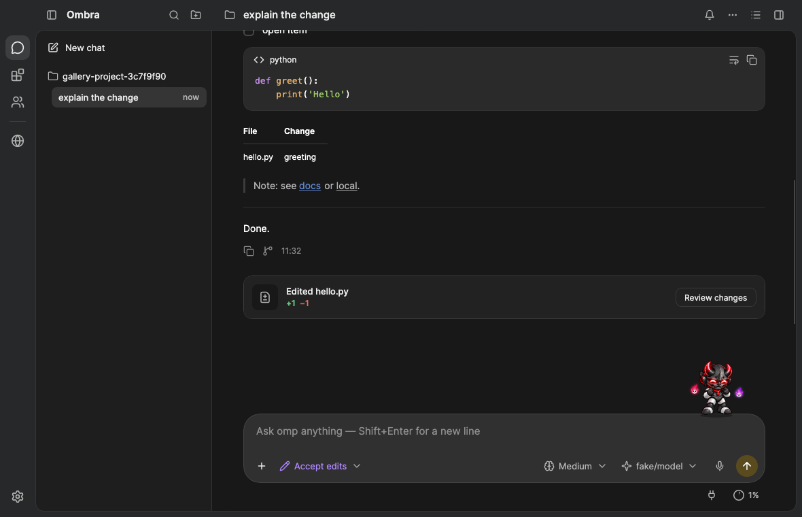
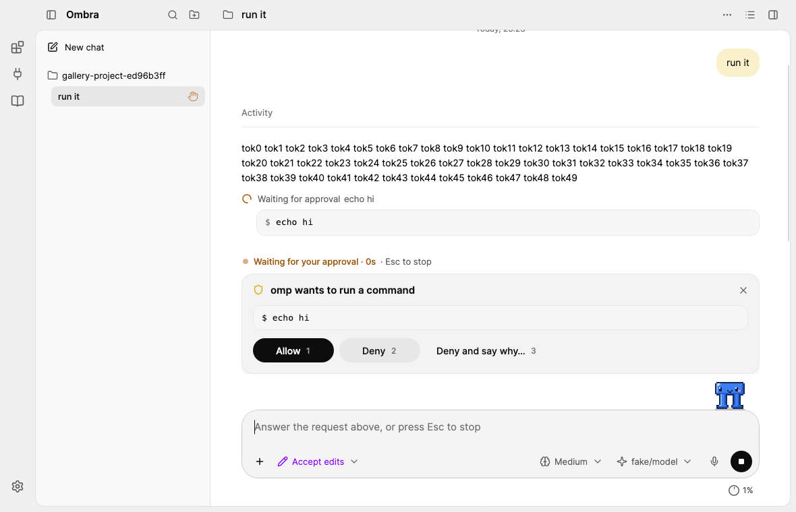
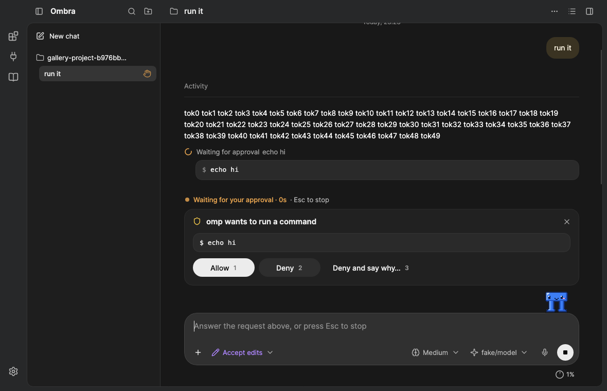

# Design system

The client's own design system: its tokens, component styles and icons. This page says how the pieces are wired and
the conventions to follow when adding UI.

Files:

| File | Role |
|---|---|
| `src/Ombra.App/Views/Tokens.axaml` | Design tokens: colours per theme, radius, type scale, shadows. Edited by hand |
| `src/Ombra.App/Views/Styles.axaml` | Component styles (style classes) on top of the tokens |
| `src/Ombra.App/Views/Icons.axaml` | Line icons (`StreamGeometry`, Lucide on its 24-unit grid; generated by `tools/icons/lucide.py`) |
| `src/Ombra.App/Controls/Icon.cs` | `ctl:Icon`, the control that draws them |
| `src/Ombra.App/App.axaml` | Includes Tokens + Icons as resources, then `FluentTheme`, then Styles |

## Foundations

- **Colours**, light and dark (dark is the primary theme): the ChatGPT desktop (Codex) look, sampled from
  screenshots of that app — neutral greys, no warm tint. Dark: chat / window `#181818`, sidebar `#1E1E1E`, the
  chrome (title band and rail) `#272829`, raised cards `#212121`, composer `#303030`, menus, tooltips and toolbar pills
  `#2D2D2D`, text `#ECECEC` / `#B4B4B4` / `#8E8E8E`. Light: white chat, `#F9F9F9` sidebar, `#F0F0F0` chrome, `#F3F3F3` cards, text `#0D0D0D` /
  `#5D5D5D` / `#737373` (Codex's `#8F8F8F` darkened to stay AA). **One accent, the logo's yellow** (`#F2B200` light / `#F5C02A` dark, white text and marks on it, as on the logo) for Send,
  switches, checks, progress and the unread dot; links and the focus ring stay blue. The **primary button is the inverse pill** (near-white with dark text on
  dark, near-black with white text on light). `GuiBrandMark` keeps the logo's own shade.
  Theme switching is Avalonia's `ThemeVariant`; every brush is a `DynamicResource`.
- **Radius**: 4 / **8 controls, rows** / 10 tabs / **12 menus, cards, code blocks, the sheets' corners** / **16 large
  cards, settings sections** / **18 your message** / **24 composer** / full (pills) — `GuiRadiusControl`, `GuiRadius10`,
  `GuiRadiusCard`, `GuiRadiusMenu`, `GuiSheetRadius`, `GuiRadius16`, `GuiRadiusBubble`, `GuiRadiusComposer`,
  `GuiRadiusFull`.
- **Type scale**: UI 14 (`GuiFontUi`), menus, sidebar rows and step lines 13 (`GuiFontS`), messages 14 on 22 (`GuiFontMessage` / `GuiLineMessage`, Codex), captions 12
  (`GuiFontCaption`), code 13 (`GuiFontCode`, in `GuiFontMono`: SF Mono / Menlo / Cascadia Mono / Consolas); 17 for
  section titles, 20 for the page title, 24 for the empty-session greeting. The UI font is **Inter** (SIL Open Font
  License 1.1, bundled through the `Avalonia.Fonts.Inter` package, `.WithInterFont()` in `Program.cs`), with its
  contextual alternates off (`FontFeatures="-calt"` on every `Window`): they drew "0x1F" as "0×1F" and "->" as an
  arrow in text the user or omp wrote.
- **Shadows**: `GuiShadow`, `GuiShadowPopup` and `GuiShadowComposer` in light (soft layers); in dark only popups keep
  a shadow, cards and the composer rely on a hairline.
- **Components**: buttons 32 / radius 8, card actions 36 pills (`md`), the primary action an inverse pill, inputs 40
  on surface 1 with a hairline, menus a grey card with 30 px rows, status badges on the soft status colours, cards on
  `GuiCard` with radius 16. The client is a desktop window: it restyles Fluent's controls with the tokens instead of
  drawing its own.

## Tokens: two layers

`Tokens.axaml` has one `ThemeDictionaries` entry per theme (`Light`, `Dark`), each with two layers of brushes, plus
theme-independent resources after them.

1. **`Gui*`**: the client's semantic tokens, one `SolidColorBrush` each (`GuiTextPrimary`, `GuiSurface1`,
   `GuiStatusErrorSoft`, …). New XAML and C# use only these (C# looks them up by name: `CodeView`, `MarkdownView`,
   `SyntaxHighlighter`).
2. **Fluent keys** (`ButtonBackground`, `AccentButtonBackground`, `TextControlBorderBrushFocused`, `ComboBox*`,
   `CheckBox*`, `RadioButton*`, `ToggleSwitch*`, `MenuFlyout*`, `ToolTip*`, `ProgressBar*`, `ScrollBar*`,
   `SystemAccentColor*`, `SystemControlFocusVisual*`, …) so stock controls follow the tokens without per-control
   styles.

One token needs a word:

- `GuiSidebar` / `GuiPage`: a step above the window in dark (`#1E1E1E` over `#181818`) and below it in light
  (`#F9F9F9` beside white), neutral grey, so the panes separate without a hard line. `GuiChrome` (the band and the
  rail) is a step further out: lighter than the sheets in dark (`#272829`), darker in light (`#F0F0F0`), so the sheets
  read as lying under it.

**Adding a token:** add the key to both theme dictionaries (`Light` and `Dark`) in `Tokens.axaml`, then reference it with
`{DynamicResource …}`. Brushes and colours are
per-theme; radius and type sizes go after the theme dictionaries.

## Semantic tokens in use

Values are light / dark; contrast is against the window. Only the keys the styles use are listed; the rest of the
`Gui*` set feeds the Fluent keys.

| Token | Light / Dark | Used for |
|---|---|---|
| `GuiTextPrimary` | #0D0D0D / #ECECEC (19.4:1 / 15:1) | window foreground, hovered icon buttons and links |
| `GuiTextSecondary` | #5D5D5D / #B4B4B4 (6.6:1 / 8.6:1) | `.muted`, `.caption`, `.label`, `.tertiary`, `.caps`, icon buttons, tool output, code-block language |
| `GuiTextTertiary` | #737373 / #8B8B8B (4.7:1 on white / 5.3:1 on the chat, 5:1 on the sidebar) | placeholders, hints, meta (times, line numbers, the "Worked for…" line, the day over a message), menu shortcuts, section labels, disabled text. Light is a step darker than Codex's #8F8F8F (3.2:1) to stay AA |
| `GuiTextLink` / `GuiTextLinkHover` | #2563EB / #6086CC (Codex's muted blue, 4.9:1) | `link action`, Markdown links |
| `GuiTextError` / `Success` / `Warning` | #D03B30 · #1E7F3A · #9A5A12 / #F28B82 · #6BC47E · #E0A04F | error text, diff gutter, warning text |
| `GuiTextOnAccent` | #FFF in both themes | text and icons on the yellow accent (Send, checks) |
| `GuiTextOnDanger` | #FFF | text and icons on danger fills |
| `GuiTextOnInverse` | #FFF / #0D0D0D | text on `inverse` and `accent` (primary) buttons |
| `GuiWindow` | #FFF / #181818 | window, conversation, right panel |
| `GuiPage` / `GuiSidebar` | #F9F9F9 / #1E1E1E | events panel / the sidebar's and the settings list's sheets, terminal panel |
| `GuiChrome` | #F0F0F0 / #272829 | the window's chrome: the title band across the top and the icon rail, one surface (sampled: band #272829, rail #282929) |
| `GuiChromeEdge` | #E1E1E1 / #333435 | the sheets' hairline edge (sheet frame, sidebar sheet, Events), splitters |
| `GuiChromeTabActive` | #FFF / #393B3C | the shown tab in the band |
| `GuiToolbarPill` | #F0F0F0 / #2D2D2D | a toolbar's grouped pill, a lone pill action, a pill field, a pill segmented track |
| `GuiSurface1` | #FFF / #2A2A2A | text boxes, the browser's page-question card |
| `GuiSurface2` | #FFF / #2D2D2D | menus / flyouts / popups / tooltips' kin (with `GuiShadowPopup` and a hairline) |
| `GuiCard` | #F3F3F3 / #212121 | cards on the chat (`card`, `dialog`, `banner`, `widgets`), the change card |
| `GuiComposer` | #F4F4F4 / #303030 | the message box (`Border#ComposerBox`) |
| `GuiUserBubble` / `GuiUserBubbleText` | #E7EEFB · #0D0D0D / #213F73 · #F7FAFE (Codex) | your message's bubble and its text |
| `GuiStepText` | #5F5F5F / #A3A3A3 | step lines (a tool call, a group of them): their icon and words |
| `GuiHairline` | #EBEBEB / #2B2B2B | the rule under a turn's "Worked for…" line, notices' rules, the change card's row rules |
| `GuiCodeBlockBorder` | #E8E8E8 / #333333 | code cards' hairline (code blocks, Shell cards, outputs, diffs) |
| `GuiChangeHead` / `GuiChangeRow` / `GuiCardBorder` | #F7F7F7 / #232223 · #FFF / #1C1B1C · #E3E3E3 / #3C3C3C | the change card's header, its file rows and its hairline; also the table's header rule, the quote bar, the "Jump to latest" ring |
| `GuiTableRule` | #F0F0F0 / #222222 | the rules between a table's rows |
| `GuiFill1` (+`Hover`, `Pressed`) | black 5 / 8 / 11 % · white 6 / 9 / 12 % | flat-button hover and press, chips, attachment, secondary buttons, the change card's icon tile |
| `GuiFill1OnWindow` | #F3F3F3 / #222222 | opaque fill 1 over the window (Files pane rows, panes) |
| `GuiCodeBlockBg` / `GuiCodeBlockHeader` / `GuiInlineCodeBg` | #F7F7F7 / #2A2A2A · the same · black 6 % / #303030 | code cards (code blocks, Shell cards, outputs, diffs) / their header row (the card's own fill, no rule) / inline code chips |
| `GuiFill2` | black 7 % / white 10 % | tags, selected tab, current menu item, open panel toggle, the open "+" menu |
| `GuiAccent` (+`Hover`, `Pressed`, `Disabled`) | #F2B200 (#FFC21A, #D99E00, #F5DD8F) / #F5C02A (#FFCD3C, #E0AC14, #5A4B1F) | Send (`accent send`; the dimmed yellow while there is nothing to send), switch on, check boxes, radio buttons, progress, page-comment pins |
| `GuiBrandMark` | #E0A100 / #FFD24D | the logo and the dialog mark (the accent is the same family) |
| `GuiStatusUnread` / `GuiStatusUnreadRing` | #E0A100 / #F5C02A | the sidebar's unseen-reply dot (the accent's yellow) |
| `GuiFocus` / `GuiFocusRing` | #2F6BDA / #5E9CF5 | focused text box border; keyboard-focus ring (2 px, inset) |
| `GuiInverse` (+`Hover`, `Pressed`) | #0D0D0D / #ECECEC | the primary pill: `accent` and `inverse` buttons (Stop) |
| `GuiModeManual` / `AcceptEdits` / `Plan` / `Bypass` | #737373 · #8700FF · #006666 · #AB2B3F / #8E8E8E · #AF87FF · #48968C · #FF6B80 | the permission-mode pill and the mode marks in its menu (Send keeps the accent in every mode) |
| `GuiStatusRunning` / `Waiting` / `Unread` | #2E8B47 · #B5661B · #E0A100 / #6BC47E · #E0A04F · #F5C02A | session status dots: working (pulsing), needs your input (amber), unseen reply (the accent's yellow) |
| `GuiDiffAddedBg` / `WordBg` / `Bar` / `Text`, `GuiDiffRemovedBg` / `WordBg` / `Bar` / `Text` | row fill 12–14 %, changed words 35–40 %, a solid bar and AA text; dark sampled from Codex: green #6BC47E, red #E75543 (text #EE6A5C) | diff rows (conversation and the Files pane's Changes): fill, word marks inside a changed line, left edge bar, sign and numbers, +N −M counts |
| `GuiDiffNewFileBg`, `GuiDiffMovedBg` / `Text` | a lighter green fill; blue at 12–20 % with AA text | a new file's lines (not a wall of green); the Renamed / Moved badge |
| `GuiBorderSoft` / `GuiBorder` / `GuiBorderStrong` | black or white at 6–7 / 10 / 25–20 % | card and code-card hairlines, the composer / menus, text boxes, separators / switch track off |
| `GuiBorderDarkOnly` | transparent / white 8 % | hairlines that only dark needs |
| `GuiStatus*Soft` | pale status fills / deep muted fills | badges, `notice`, `banner error`, `chip danger` |
| `GuiStatusInfo` / `Success` / `Error` / `Warning` | info = amber #B07A00 / the accent #F5C02A | status dots and marks (3:1 is enough for graphics); info marks what is in progress: the current todo, a running pill, the working state dot, counts |
| `GuiShadow` | `0 1 2 #000 4%, 0 4 14 #000 6%` / none | cards, raised segment |
| `GuiShadowPopup` | `0 2 6 #000 6%, 0 10 32 #000 12%` / `0 10 32 #000 40%` + a 1 px white 5 % ring | menus, drawer sidebar |
| `GuiShadowComposer` | `0 1 2 #000 4%, 0 4 16 #000 5%` / none | the composer |
| `GuiBackdrop` | black 20 % / black 50 % | `Border.scrim` behind a drawer or a sheet |
| `GuiImageBackdrop` | #F9F9F9 / #181818, opaque | `Border.image-backdrop` behind the image viewer (nothing of the conversation shows around the image) |
| `GuiRadius4` / `8` / `10` / `12` / `16` / `Full`; `GuiRadiusControl` / `Card` / `Menu` / `Bubble` / `Composer` | 4 / 8 / 10 / 12 / 16 / 999; 8 / 12 / 12 / 18 / 24 | 4: tags · 8: buttons, menu rows, inputs, tooltips, sidebar rows · 10: the band's tabs, rail buttons · 12: menus, code cards, change card, image thumbnails, new-tab tiles, recent rows · 16: cards, dialogs, settings sections · 18: your message · 24: composer · full: chips, badges, toolbar pills, `md` / `accent` / `inverse` / `outline` buttons |
| `GuiSheetRadius` / `GuiSheetRadiusLeft` / `GuiFrameInset` | 12 / 12,0,0,12 / 0,0,8,8 | the sheet frame's four corners / the sidebar's and the settings list's sheet / the chrome showing right of and under the sheets |
| `GuiChromeBand` / `GuiSheetMargin` | 44 / 0,44,0,0 | the band's height (header, sidebar's top row, panel strip; `MainWindow.TitleBarHeight`) / what starts under it (the sheets, the settings page, Events) |
| `GuiFontUi` / `Message` (+`GuiLineMessage`) / `Caption` / `Code` | 14 / 14 (22) / 12 / 13 | inputs / `.body` / `.tertiary`, `.caption`, tooltips, menu shortcuts, meta times / `.mono` |
| `GuiFontL` / `M` / `S` / `Xs` / `Xl` / `Xxl` | 17 / 15 / 13 / 12 / 20 / 24 | `.section` / card titles / buttons, menu rows, `.muted`, `.label` / `.caps` / `.page-title` / greeting |
| `GuiMenuRowHeight` | 30 | `Button.menu-item`, `MenuItem` |

Fluent's own `ControlCornerRadius` is 8, `OverlayCornerRadius` 12 and `ControlContentThemeFontSize` 14.

## Layout: the ChatGPT desktop app as the reference

Structure, placement, sizes and colours follow the ChatGPT desktop app (Codex), measured on its screenshots — nothing
copied; the accent, type and components are the client's own (above).

| Area | Arrangement | Size |
|---|---|---|
| Sidebar | top row in the band: sidebar toggle · name · search · add project; on its sheet: New chat (shortcut on hover); search; **Pinned** (omp's pins), then sessions **grouped by project** (a project row: folder icon · name; ⊖ remove from sidebar and + new session on hover, both with tooltips) as one-line rows (title · age, or a status dot: running pulses `GuiStatusRunning`, needs input `GuiStatusWaiting`, unseen reply `GuiStatusUnread`; pin and ⋯ replace it on hover / focus); bottom: Update (Settings is on the icon rail); the right edge drags the width (2 px `GuiFocus` line while hovered). Only beside the conversation (the rail's Chats, `MainViewModel.ShowSidebar`): the settings, Team and Browser pages take its width, and ⌘B (with its menu item and palette entry) is off on them | 260 default, 220–480 (kept); top row 44 (the band); rows 30 / 32, radius 8; open item on fill 2 |
| Title bar (macOS) | no separate title-bar strip: the client area extends under it (`MainWindow.Chrome.cs`) and the 44 px band — the sidebar's top row, the header, the right panel's tabs (and the settings page's band, the Browser page's tabs; the Team and Browser pages lie on a sheet under it), with the rail beside it — is the title bar: the traffic lights sit over the rail and the band's start, centred in the band 16 pt from the left edge as in the ChatGPT app (AppKit puts them back at the top of its lower 28 pt title bar whenever it lays it out again — a resize, a new window title, a theme change — so `MainWindow.PlaceTrafficLights` holds them: `Platform/Mac/MacTrafficLights.cs` places them again on every frame change of the title bar's container or a button; the feature smoke's `title-bar` section measures them against the band's row in the real window), what is in the band under them starts after them (the sidebar's top row — or the header or the Browser page's tabs while the sidebar is hidden, or the narrow settings header — 40 px in; the window's `traffic-lights` class, `Styles.Workspace.axaml`; the rail's buttons always start under the band); the empty parts of the band, the chat's title and the empty rail move the window and a double-click zooms it (`WindowDecorationProperties.ElementRole="TitleBar"`, hit-testable transparent backgrounds); in full screen the lights hide and the insets go. Windows and Linux keep their system title bar over the same band. The window's title (`WindowTitle`) is still set for Mission Control and accessibility | 44 high |
| Icon rail | left of the sidebar, full height, also while the sidebar is hidden and on the settings page (`Border.rail`, transparent on the chrome: one surface with the band): Chats · Plugins · MCP (Connectors) · Skills under the band, Settings pinned at the bottom, as 36 px `Button.rail-item` icon squares (radius 10, tooltips to the right); the one shown is lit (fill 2, `MainViewModel.Rail.cs`): Chats while the conversation is, the others while their settings page is; Chats leaves the settings for the conversation; Skills opens Plugins and skills scrolled to its Skills card | 52 wide |
| Header | in the band: the project's folder (an icon button: the project menu, the name in its tooltip) · the chat's title (medium, trims; double-click renames it where the header is not the macOS title bar) · branch, trimming first — on the right ⋯ (the chat menu: the session's actions with their `/command`, then **Panels**: Files · Changes · Background tasks · Plan · Browser · Terminal with shortcuts and a tick on the one shown), the summary toggle and, while the right panel is hidden, its toggle (`IconPanelRight`); a dot on ⋯ and the summary while background tasks run unseen; sidebar toggle only while the sidebar is hidden; no divider line (the sheet's edge is the line) | 44 high |
| Summary | the header's summary popover (a menu card, 300 wide): the project, **Changes** with the chat's +N −M (opens the Changes tab), **Plan** with done/total (when there is one), then **Background processes** — running subagents and jobs (open Background tasks) and live terminal tabs (open the terminal) — or "Nothing runs in the background" (`MainViewModel.Summary.cs`) | 300 |
| Right panel | right of the conversation, full height, resizable (`Views/Panes/RightPanel`), transparent on the sheet frame (its top-right corner the frame's): its tabs in the band — rounded 32 px tabs (`Border.panel-tab`, radius 10: icon · title · ×, the shown one lifted on `GuiChromeTabActive` with a hairline, × only on it and under the pointer; they share the width and scroll past 112 px each: `TabStripPanel` / `TabStripRow`) for the tools (Files, Changes, Background tasks, Plan) and the browser's pages, + (`icon sm`) for the new-tab page, the panel toggle at the far right (`icon on`: lit while the panel shows) — then on the sheet a 44 px tool line (what the tool counts, Refresh as an `icon pill` for files) and the tab. Changes is the Files pane on git's changes (this session's without git), without "All"; its Go to file is a `search pill`, its mode a `segmented pill`, an open file's actions one `toolbar-pill`. Hiding the panel keeps its tabs; the toggle brings back the last one | 480 default, 320 min |
| New tab | the right panel's + (`Views/Panes/NewTabPage`): **Tools** (14 px medium heading) as two columns of `Button.tool-card` tiles (44 high, `GuiCard`, radius 12, no outline, 8 px gutters: icon · name · the shortcut on a `Border.key-chip` pill) — Changes ⇧⌘G, Files ⇧⌘F, Terminal Ctrl+`, Background tasks ⇧⌘T, Plan ⇧⌘P, Browser ⇧⌘B; a tool takes the page's place (the terminal opens under the chat). **Recent**: the files this chat changed, the latest first (at most 8, `Button.recent-row`: radius 12 with a hairline under it, the file icon on a 32 px `Border.recent-tile` · name over its folder · +N −M), only when it changed some | panel width |
| Terminal | under the conversation and the right panel (Ctrl+`): a tab row (`Border.tab`: terminal icon · title · status · ×), + (New shell / omp TUI) after the last tab, the chevron that hides it at the far right; the splitter above drags its height (kept) | 260 default, 120 min; the conversation keeps 300 |
| Conversation | one centered reading column (`Styles.Session.axaml`), Codex's: the day and time over a message that starts the conversation or follows a pause (a new day or an hour since the last message; `MessageTimes`), centred, 12 px meta grey; your messages right-aligned bubbles tinted with the brand yellow (`GuiUserBubble` #FBF0CC / #3A3322, radius 18, at most 515 wide), their images (78 px squares) and comments pill over them, and under them on hover the time, Copy and Rewind to here; each turn then has Codex's **"Worked for 1m 18s ›"** line (`TurnFoldRowViewModel`, `ViewModels/TurnFolds.cs`) — 13 px meta grey over a full-width hairline — that folds what the turn did before its answer: the replies along the way and its steps; finished turns are folded, opened they show where they were; while a turn runs it reads "Activity", has no chevron and folds nothing; the length comes from the run as the client saw it, or in a loaded history from the times omp saved with the message and the last reply; a turn that only answered has no line. Assistant prose plain, no bubble, 14 / 22, paragraphs 12 apart; its actions line under the turn's answer, always shown: Copy, "Interrupted" when stopped, the time. Steps are Codex's step lines (`ViewModels/StepGroups.cs`): tool calls in a row (with only replies with nothing to read between them; a failed or stopped call stands alone) are one grey 13 px line with the icon of their kind (`StepKinds`) and what they did in words ("Read files, ran a command"; while one runs, that one: "Running npm test"), opening to one line per call: its kind's icon (a spinner while it runs, a red cross when it failed, a dashed circle when stopped) · the verb · what it acts on · "exit 127" · +/− · what it found · how long. A command opens into its **Shell card** (`GuiCodeBlockBg`, radius 12: a "Shell" bar that folds it and sticks, `$ command`, all its output, "Exit code N" at its foot); while it runs the card shows its newest lines live. Under the turn's answer, Codex's **change card**: "Edited 3 files +40 −2" and "Review changes" (the right panel's Changes), then a 32 px row per file (folder grey, name, +N −M) opening it in the Files pane; three rows, then "Show N more files". Code blocks are code cards (#2A2A2A, a #333 hairline, radius 12) with a sticky header: code icon · language on the left, wrap and Copy on the right. Tables have no frame or fills, a #3C3C3C rule under the header and #222 rules between rows. Notices are centred 12 px words between two hairlines, an error or warning with its mark | 768 max width; bubble max 515; step line 28 high; change rows 32 |
| Fold tree | what a line folds hangs under it as a tree (`Controls/TreeIndent`, `RowViewModel.Depth`): a finished turn's "Worked for…" line, then a step group's line, each puts the rows it folds 22 px further in, with a 1 px `GuiBorderSoft` guide down from under the line's icon; consecutive rows join into one guide, so before folding a line you see everything it will hide. A running turn's "Activity" folds nothing and adds no level; the answer, failed or stopped replies, notices and the change card stay at the column's edge | 22 per level |
| Rhythm | every entry of a turn starts with its own mark at the column's edge and its words at the steps' text edge (24): a step its kind's icon, a group its first kind's, the thinking line ("Thinking… 9s" / "Thought for 4s", 28 high) `IconBrain`, an agent's message its card; the reply's prose has none. Space between entries: a reply 10 above and below, its parts (thinking line, prose, error, actions) 8 apart; a step or group line 28 high with 2 above and below (32 a step); the "Worked for…" line 8 above and 16 under; an agent's message card 8 above and below. The thoughts hang under a 2 px bar that runs down from the thinking icon | step 32, reply parts 8 |
| Empty session | the app mark (112) and "Oh? You’re approaching ‹project ▾›?" (heading 5, 24) centered over the message box — in a chat without a project "Oh? You’re approaching ‹me ▾›?" — the project (or "me") on the app's chip (fill 1, a full pill, hover fill 1 hover) that opens the project menu below it; the project menu is the message box's menus' card (a heading, icon · medium name · muted path rows, a tick on the current one, Open folder… under a separator); three starter prompts as outlined pill chips that fill the box; shown while the conversation has only notices | 640 max |
| Setup | omp cannot start in a new session: the page shows only what to do — the app mark (onboarding) or a warning mark, a title, one sentence, one accent action and the alternatives, the raw error under *Show details*; no message box. Mid-conversation the same content is a card above the message box | 520 max |
| Questions | one card chrome for approvals, questions, confirmations and inputs (`Border.dialog`): a mark (shield for approvals, sparkle otherwise) and the title in words — "omp wants to run a command", or the question — then the command or details in a mono code box, omp's reason as a muted line, the answers; choices numbered 1–9 (the digit picks, omp's "(Recommended)" as a `status` badge), approvals Allow `1` / Deny `2` (omp offers no "always allow"), close (×) in the card's corner | — |
| Composer | Codex's message box: a rounded card (`GuiComposer`, radius 24, a soft hairline; `GuiShadowComposer` in light), the placeholder at the top; above the text: the command menu (the slash menu; while an `@name` is typed, the project's files and folders, each with a file / folder icon, the name in mono and its folder muted), queued messages (grey one-liners with their tag and ×), long pastes ("Pasted text +N lines" chips with ×), code comments (comment icon · `app.py:41` in mono secondary · the comment · ×), page comments (numbered chips), images; the toolbar at the bottom of the card, left: "+" (a bare 32 px circle, filled while its menu is open; a menu: attach images, commands and skills, connectors, plugins, comment on the page) and the permission-mode pill (icon shield / pencil / alert, in the mode's colour; its menu opens upward from the pill's left edge); right: thinking effort, model, dictation, then a round send / stop button. Send is the blue accent in every mode, the dimmed blue (`GuiAccentDisabled`) with a white arrow while there is nothing to send; Stop is the inverse circle. The model menu opens above the card, its right edge on the model chip, so the message stays readable; the thinking menu's rows are a label and a one-line description; the slash menu lists what only omp's terminal runs last, under a `TextBlock.menu-group` heading. Under the card, outside it: the project folder (new session only) on the left, the context gauge on the right, in 28 px quiet pills. Styles: `Styles.Composer.axaml` | radius 24; field min 48; toolbar pills 30; send and "+" 32 circles; row under the card 28 |
| Shortcut sheet | ⌘/ (Ctrl+/) or `/hotkeys`: a menu card over a scrim, its groups in 300 px columns (two when the window allows), each row the action (a tertiary note under it when it applies only sometimes) and its keys as `Border.keycap` (fill 1, hairline, radius 4, 12 px medium secondary); Esc, × or the scrim closes it | max 660 wide |
| Image viewer | a click on an image preview (`Controls/ImageViewer`, `Styles.Images.axaml`): the image over `GuiImageBackdrop`, fitted to the window and never enlarged, with name, pixel size and "2 of 3" at the top left and ← · → · **100 %**/**Fit** · copy · open in default app · × at the top right; a click on the image or Space toggles 100 % (scrolling), ←/→ step, Esc or a click on the backdrop closes; Tab cycles inside it | window |
| Preview | the browser tab of the right panel (`Controls/PreviewPanel`), its pages as the panel's tabs: a 48 px toolbar of pills — back \| forward · reload in one `toolbar-pill`, the address as a `TextBox.pill` with open in the browser at its end, the "omp" pill while the agent drives the page, device · annotate in another pill; local server addresses from tool output as chips; the native web engine of the OS (WebView2 / WKWebView / WebKitGTK), a card with "Open in browser" when there is none. The × of the user's own first page takes the browser out of the panel | panel width |
| Page questions (preview) | a page's sign-in, alert / confirm / prompt, *Leave this page?*, file, download, permission and popup as one `Border.dialog` card (surface 1, `GuiShadowPopup`) centered over the page: the web view is hidden (native views draw over Avalonia) and its picture, taken just before, shows under a `GuiBackdrop` scrim; a mark by kind (key, file, download, shield, external, globe), the title says who asks ("studio.example.com wants you to sign in", "localhost:3000 says"), a muted detail line, the page's text, error / warning lines, the fields, then the buttons right-aligned with the accent last (Enter); Esc cancels; "N more" in the corner when others wait | 400 max |
| Annotate (preview) | Codex's page comments: the 💬 toggle (`icon on` while active) puts the page in annotate mode — drawn by the page script in a closed shadow root: a 2 px blue outline with a dark tag (`button#buy 220×56`), a white comment card (radius 12, textarea, Cancel / yellow Comment with ink text), numbered **pins** (22 px yellow circles, ink number, white ring) and a dark hint pill at the bottom; the panel lists the comments under the page (pin number, comment, element in mono tertiary, ×) with Clear and an accent Send; the composer shows "N comments on the page" as an attachment chip | pins 22; list max 200 |
| Changes (Files pane) | a file git sees changed: under the viewer header a `segmented` **File · Changes +N −M** and, in Changes, "Revert file…" (`flat danger-text`; "Delete file…" for a file git does not have) that opens a `notice warning` question with a `danger` Revert / Delete and a flat Cancel; the diff in one virtualized list (`Styles.Files.axaml`): per hunk git's `@@ … @@` in 12 px mono tertiary on `GuiFill1OnWindow` with a flat **Revert** at its end, then the lines as the conversation's diffs draw them (`diff-row` fills, number, sign, coloured code, wrapped); a 20 px "+" at a line's start shows on hover or keyboard focus and opens a comment box under the line (surface 1, hairline, radius 8; Cancel / accent "Add comment"; Enter adds, Esc closes) | hunk header 30; rows 20 |
| Dictation | the mic button or Ctrl/⌘+Shift+Space turns the message field into the dictation bar (`Controls/DictationBar`): cancel · level waveform · time · finish (accent circle); Esc cancels, Enter inserts the text at the caret (never sends) | field height |
| Cards above the composer | recovery, sign-in link, tasks, the activity line and the approval / question card; while the conversation is shorter than its view they are drawn up to just under its last row (`MainWindow.FollowTranscript`), so a question follows the conversation instead of waiting at the bottom; they scroll when the window is too low for them and the composer, which always stays on screen (a new question scrolls its answer buttons into view) | same 768 column |
| Activity line | in the column above the composer, in a slot that keeps its 20 px when idle (a run starting or ending moves nothing); while omp works or after an error: pulsing dot · what it does now ("Thinking", "Writing", "Running bash", "Waiting for your approval" in the warning colour) · elapsed time · "Esc to stop"; model, RPC and context in its tooltip | 12 px |
| Pet | ONI-01 (`Controls/PetPerch`, `Controls/PetStage`, `Controls/OniView`, logic and drawing in `Pets/Oni/`, art in `Assets/Pets/Oni01/` — the delivered runtime, not redrawn) on the composer's top edge, 20 px from its right end, its feet on the border; it has a band of its own (the composer's top margin grows by its box's height), so it never covers the conversation, a card or a question; only its box (1.3 × 1.1 of its height) takes the pointer, its spirits, the seal and the sign over its head are drawn around it; a click opens a speech bubble to its left (surface 2, radius 12) and never takes focus; hidden on the setup screen, the settings page and in a window under 520 px tall (the band goes with it). Carried, it lifts into a window of its own (`Controls/PetWindow`: borderless, see-through, topmost, no taskbar entry, the box plus room for what is drawn around it plus the bubble or message box while they show, so clicks around it reach other apps) anywhere on the monitors' work areas (`Pets/PetDesktop`), or stays in the window with Settings → Pets → Inside the window. Art: whole PNG drawings per pose (`frames/`), entry transitions (`transitions/`) and effect sheets (`effects/`), placed by the manifest's anchors at `height × state.scale` (transitions `height / referenceHeight`); a rigid mask with red glowing eyes, no pupils, no mouth or eye animation, no skeletal deformation. Motion is the reference players' (`tools/pets/oni-01/runtime/*.cjs`), ported step for step and checked against their traces (`OniParityTests`): the director's bridges, settles and loops (`OniDirector`), the drag body on its stiff spring with the pendulum lean and the fall (`OniDragBody`, `OniCarry`), the spirits' poses on springs. Layers: ground shadow, back effects (working's seal and rings, error's interference), back spirits, the body turned about the nape, landing dust over the boots, front spirits, the sign (dots / ? / !! / z). Light theme: the effect sheets' filters and darker glows. Sheets decoded once per size and screen density, scaled down once to what is shown (`OniAtlases`), shared by every view, let go 3 s after the last one; spirit glows baked once per theme. Frames from the screen's clock (`RequestAnimationFrame`) only while shown in the active window (on the desktop: while the app is in front, or behind other apps at 30 fps while omp is busy, asks or reports); asleep 30 s it rests on its still; a question or fault unanswered for 2 min goes on at 15 fps; reduced motion shows each pose's still. Previews: `screens/oni-light.png`, `screens/oni-dark.png` | 64 / 80 (default) / 96 tall |
| Tasks | omp's todo list as one line above the composer: the task in progress, done / total, a chevron; open, the whole list with checkboxes (done: struck through; in progress: an info-coloured box with a dot) | 32 high line; list max 180 |
| New session | the greeting, the composer and the row under it as one group in the middle of the conversation's frame (as much space above as under it, with the terminal open too: `MainWindow.FitEmptyState`); with the first message the composer goes to the bottom | — |

**Keeping things in place.** The conversation stays on its latest message through resizes, panels opening (terminal,
tasks, a question, the preview) and rows growing — re-anchored inside the layout pass, so no frame is drawn at the old
offset — until the reader scrolls away (wheel, scroll bar, keys); then "Jump to latest" (a round ↓ centred over the
conversation's bottom, just above the composer) appears, and the view holds
still until the reader comes back within 24 px of the bottom (`Views/ChatScrollController`, the one writer of the
offset). Rows keep their measured height, remembered with each row across chat switches (`Controls/TranscriptPanel`);
a row not measured yet is placed by an estimate from its own text (`Views/TranscriptRowHeights`), which measuring other
rows never changes, so a row changing above the view never moves what is on screen and the scroll bar's length holds
while its thumb is dragged. A streaming reply only re-renders its last Markdown block, and a long reply builds only the
blocks within half a view of the screen (`Controls/MarkdownView`). Side panels never take
the conversation below 420 px: the sidebar gives way first, then the docked panels narrow to their minimums (right
panel 320, Events 320); one that no longer fits beside the conversation lies over it from the right edge — down to the
cards, never over the composer — until it is hidden (`MainWindow.FitPanels`). The terminal takes height, never the
conversation's last 300 px (`MainWindow.FitTerminal`).

Model and thinking effort live in the composer, next to the message they apply to; the permission mode and the context
gauge sit in the row under it. The model list opens upwards from its chip. Each row sheds labels only as far as its
content needs to fit (`MainWindow.FitComposerToolbar`, measured): in the card a shorter model, the thinking pill as its
icon, the model as its icon, then no thinking pill; under it a shorter project, the permission pill as its icon, the
context without its percentage, the project as its icon. Voice and send always stay on screen.

## Components (Styles.axaml)

### Buttons

| Classes | Looks like |
|---|---|
| *(none)* | secondary: fill 1, primary text, 32 high, radius 8, 13 px medium; hover / pressed step the fill |
| `accent` | primary: the inverse pill — near-white (`GuiInverse`) with dark text on dark, near-black with white text on light (Fluent's `AccentButton*` keys), full radius; disabled = the same at 50 % |
| `danger` | the one destructive action of a confirmation: error fill, white text (not on `chip`, `menu-item`, `flat`) |
| `md` | a card's actions: 36 high pill, 14 px (combine: `accent md`) |
| `inverse` | the same inverse fill as `accent`, a pill (Stop); disabled = the same at 50 % |
| `outline` | a quiet pill with a hairline (transparent, `GuiBorder`), fill 1 on hover: the secondary action beside a primary pill (Review changes) |
| `flat` | no fill until hovered (fill 1), pressed fill 1 pressed |
| `icon` | 32 × 32, radius 8, no fill, secondary foreground → primary on hover; `icon sm` 28 × 28 (a strip's own +, a panel's ×, the terminal's chevron); round 28 inside a `Border.toolbar-pill`; `icon wide` for icon + text |
| `link` | no chrome, 12 px secondary text → primary on hover |
| `link action` | blue link text (`GuiTextLink`) at 13 px |
| `chip` | full radius pill, 32 high, fill 1 (also `ComboBox.chip`); `chip danger` = error soft + error text |
| `chip ghost` | the composer's pills: no fill until hovered, secondary text |
| `send` | 32 px circle, icon only — `accent send` (Send: the yellow accent, not the inverse pill), `inverse send` (Stop) |
| `round` | full radius for an `icon` button (dictation); `attach` ("+": primary icon, fill 2 while its menu is open) |
| `icon on` | a panel toggle whose panel is open: fill 2, primary icon |
| `segment` in `Border.segmented` | a 2–3 option choice: fill 1 track (radius 8), the chosen segment (radius 6) raised off it (`GuiSegmentSelected`: white in light, #4A4945 in dark) with the small shadow; an unavailable segment is tertiary text on the track |
| `sidebar-action` | a flat 32 px row with an icon (New chat, Back to app); `current` = fill 2 |
| `icon pill` | a lone toolbar action: a 32 px round pill on `GuiToolbarPill` (see Toolbar pills) |

`accent` is Fluent's `AccentButton` theme; its colours come from the Fluent keys in `Tokens.axaml`, not from a style
in `Styles.axaml`. Other button classes are scoped to one
place: `option` (dialog choices), `session`, `sidebar-action` (`primary` = New session), `menu-item`,
`ToggleButton.expander` (the chevron rotates 90° when checked), `ToggleButton.tool-row` (a whole tool line; its
`Icon.chevron` rotates when the output is open), `ToggleButton.todo-head` (the task line).

**On / off and done / not done.** A setting that is on or off is a **switch** (`ToggleButton.switch`: a 36 × 20
pill; off = a mid-grey track (`GuiBorderStrong`, darker on hover), on = the yellow accent, a white knob that slides; focus =
the focus ring inside the track; disabled at 40 %), in a row with its name and description on the left —
as in the ChatGPT app's settings; not a check box. A task that is done or not is a **checkbox** (`Border.md-check`, 16 px,
radius 4, a strong border; `checked` = inverse fill with a check; `active` = info border; `dropped` = pale
with a cross), drawn — never the ☑ / ☐ / ◐ glyphs, which every font draws differently.

### Inputs

`TextBox` sits on surface 1 with a `GuiBorder` hairline, 40 high (medium; `search` and `sm` are small, 32), radius 8;
the border turns `GuiBorderHover` on hover and **focus blue** (`GuiFocus`, still 1 px) on focus. Placeholders are the
tertiary text at full strength (AA). `TextBox.search` leaves room for a leading `ctl:Icon` in `InnerLeftContent`. The
composer is the exception: `Border#ComposerBox` is the field (`GuiComposer`, `GuiBorderSoft`, radius 24) and the `TextBox`
inside stays bare in every state.

### Cards and surfaces

- `Border.card`, `.dialog`, `.banner`, `.widgets`: `GuiCard`, radius 16, a `GuiBorderSoft` hairline, `GuiShadow` (light
  only), padding 16,14 (`widgets` 14,10). `banner error` is flat error soft.
- **A rounded card with a hairline that clips its content** (`ClipToBounds`: code cards, the Shell card, outputs, diff
  cards, the change card, an agent's message, details boxes, image frames) also sets `ctl:InnerClip.IsEnabled` in its
  style (`Controls/InnerClip`). Avalonia clips the content to the card's outer edge and draws the hairline first, so a
  header or row with its own fill painted over the curved corners and the hairline broke there; the content is clipped
  to the inner edge instead (the radius less the hairline).
- **The frame** (`Styles.axaml` "Surfaces"): the window's background is the chrome (`GuiChrome`) — the title band
  (`GuiChromeBand`, 44) across the top and the icon rail down the left are one L-shaped surface. Under the band, right of
  the rail, `Border.sheet-frame` is the content's sheet: `GuiWindow`, all four corners rounded (`GuiSheetRadius` 12),
  a `GuiChromeEdge` hairline all round; the chrome shows 8 px right of it and under it (`GuiFrameInset` on the window's
  root grid), inside the window's own corners: on macOS 26 those are the system's new, rounder ones (as the ChatGPT
  app's) only because the packaged launcher names SDK 26 (`tools/package/package.sh`, `vtool`); a build run with
  `dotnet run` gets the old, tighter corners. The sidebar (`Border.sidebar-sheet`) and the settings
  list (`Border.settings-sidebar`) are sheets of their own over its left part (`GuiSidebar`, `GuiSheetRadiusLeft`). The
  header, the sidebar's top row and the right panel's tabs are transparent in the band; the right panel is transparent
  on the sheet (opaque only as an overlay over a narrow conversation); splitters start under the band, so the band runs
  across unbroken. The Events panel is a sheet under the band too.
- **Toolbar pills** (the ChatGPT app's panel toolbars): `Border.toolbar-pill` groups related icon buttons on one
  `GuiToolbarPill` pill (32 high, full radius; the buttons inside 28 round, a `Border.toolbar-divider` between
  groups) — the browser's back | forward · reload and its device · annotate, a file's actions; a lone action is
  `Button.icon.pill` (a round pill of its own: the panel's Refresh); a field is `TextBox.pill` (the address,
  `search pill` for Go to file); `Border.segmented.pill` is a segmented choice with a pill track and pill segments.
- **Dialog card** (`Border.dialog`, `Styles.Session.axaml`): the card above — approvals and questions look the same. A
  brand-mark icon (`ctl:Icon.dialog-mark`), the title (`dialog-title`, 15 semibold), the details in `Border.details`
  (code surface, hairline, radius 12), then **Allow** (`accent md`) and **Deny** (`md`) or the numbered
  `Button.option`s.
- `Border.menu` and every `Flyout` / `MenuFlyout` / `ContextMenu`: surface 2 (`#2D2D2D` dark), radius 12, a `GuiBorder`
  hairline, popup shadow, 5 px around the rows. Rows (`Button.menu-item`, `MenuItem`) are 30 px (`GuiMenuRowHeight`),
  13 px, radius 8, fill 1 on hover, fill 2 when `current`; an icon left, the label, and a right-aligned shortcut
  in `TextBlock.menu-shortcut` (12 px tertiary); `TextBlock.menu-heading` is a small tertiary section label. A check
  mark for the chosen row is `ctl:Icon.menu-check` in primary text.
- Right-click menus are the same card: a `Flyout` (`Placement="Pointer"`, `ctl:ChoiceMenu.CloseOnChoice`) of
  `Button.menu-item` rows, each an 18 px icon and its label, separated by `Border.menu-separator`. A menu shared by
  many rows is one resource set as their `ContextFlyout` (it takes the clicked row as its DataContext); menus made in
  code use `Controls/ContextMenus.Menu`. Text fields keep the text-editing `MenuFlyout` (Cut, Copy, Paste, Select all;
  `Styles.axaml`). `MainWindow` maps Control+click to a right click on macOS.
- `ToolTip`: near-black with white text in light, a `#2D2D2D` card with a white 10 % hairline in dark (`ToolTip*`
  keys), 12 px, radius 8, padding 8,5, at most 320 wide.
- Scroll bars: Fluent's overlay bars, thin until hovered; the thumb is `GuiBorder`, `GuiBorderStrong` on hover.
- `Border.notice`: transcript notices; plain text by default, `notice error` / `notice warning` get a soft status
  fill, radius 8 and padding 12,8.
- `Border.status` badges: full radius, 20 high, 12 px medium. `status running` (info soft / link text),
  `status done` (success), `status failed` (error), plain `status` neutral. The style centres the text in the full
  20 px (no vertical padding) and draws the 6 px dot half a pixel under the badge's middle (`translate`), on the
  lowercase letters' middle: the badge's text then shares its baseline with a 12 px text centred beside it in the
  row, at any scale. Don't nudge the text or the dot per screen.
- Transcript (`Styles.Session.axaml`): `TextBlock.date-separator`; `StackPanel.user-row` with `Border.user-bubble`
  (`GuiUserBubble`, `GuiUserBubbleText`, radius 18, padding 15,10) and `StackPanel.message-actions.user-meta` under it
  (`TextBlock.message-time` and `Button.row-action` 28 px tertiary icons; shown on the row's hover or focus);
  `StackPanel.message-actions.reply-actions` under an answer (always shown); `StackPanel.turn-fold` with
  `ToggleButton.turn-fold-head` (13 px tertiary, chevron turning down when open; disabled, not dimmed, while live) and
  `Border.turn-fold-rule` (`GuiHairline`); step lines `ToggleButton.tool-row` (28 high, 13 px, `ctl:Icon.tool-mark`
  in `GuiStepText`, `TextBlock.tool-name` / `.tool-summary` / `.group-summary` in `GuiStepText`, `.tool-took`, the chevron
  on hover, focus and while open), their result (`StackPanel.tool-result` / `TextBlock.tool-result`, 13 secondary,
  mono for output, `.failed` in error text; `Button.tool-more` "… +N lines"), `Border.console` (the Shell card) and
  `Border.tool-output` (code cards: `GuiCodeBlockBg`, a `GuiCodeBlockBorder` hairline, radius 12; their bar
  `Button.card-header` on the card's own fill; `TextBlock.console-exit`). `Border.command-output` is on
  `GuiCodeBlockBg`, radius 8. `Border.codeblock` (MarkdownView) is a code card: `Border.md-code-head` (36 high, the
  card's fill, sticky: `ctl:Icon.md-code-icon`, the language as written ("Text" without one), `Button.md-wrap` that
  wraps long lines (`on` while it does), Copy — which turns into a check for 1.5 s) over `Border.md-code-body`. The
  change card is `Border.change-card` (`GuiCardBorder`, radius 12) with `Grid.change-card-head` (`GuiChangeHead`, a 38 px
  `Border.change-tile`, `TextBlock.change-card-title`, `turn-file-stat` +N −M, `Button.outline turn-file-open`) and
  `Button.turn-file` rows (`Run.file-folder` grey before the name; `more-files` for "Show N more files"). Diff cards
  (`Border.diff-card`) are code cards too. Notices are `Grid.notice-line` (`Border.notice-rule` either side of the
  `notice-text`, 12 px secondary, centred, at most 440 wide). Inline code is a `GuiInlineCodeBg` chip (#303030, radius 4)
  drawn under the text by `MarkdownView` (mono at 0.875 of the text, still selectable with it); list markers are in the
  text's colour in an 18 px column; tables (`md-cell`) have only rules: `GuiCardBorder` under the header, `GuiTableRule`
  between rows. Running dots (`tool-dot running`, `state-dot running`, `session-dot running`) and the live "Thinking…"
  label pulse through `ctl:Pulse` (`Controls/Pulse.cs`: `ctl:Pulse.Low` / `Duration` setters in the style), never a
  style animation: those tick every vsync, and on macOS every frame redraws the whole window, so one dot kept a core
  busy at 160 Hz. All pulses step together, in phase, only while shown: in frames the window draws anyway (a reply
  streaming in), at most 30 times a second, and on their own 20 times a second when nothing else draws; nothing
  animates while idle. `Button#JumpToLatest` is a 32 px circle on the chat's fill with a `GuiCardBorder` ring.
- `Border.tag` (fill 2, radius 4), `Border.attachment` (fill 1, radius 12), `Border.tab` / `.tab.selected`.
- Image previews (`Controls/ImageThumb` in a `Button.image-thumb`): a square, cropped to fill, radius 12 (4 in the
  queue) on fill 1 with a `GuiBorderSoft` hairline (strong on hover); 52 px in a composer chip, 78 px over a sent
  message (right-aligned, 10 apart, the comments pill `Border.bubble-chip` under them), 24 px in the queue. An image
  that cannot be shown keeps the square with a tertiary `IconImage`.

### Interaction motion

`Controls/Motion` owns the window-scoped `GuiMotionFast` (120 ms) and `GuiMotionBase` (150 ms) tokens, with
`CubicEaseOut`. Row actions fade, chevrons rotate, Send scales to 0.94 while pressed, and Jump to latest fades.
Transitions belong to each control, not a shared mutable style instance. The existing OS reduced-motion setting
is re-read when the window activates: durations become zero and Send does not scale. The OS probe supports macOS
and Windows; Linux preference integration still needs a native platform pass.

Do not animate transcript heights, virtualized row measurements, or scroll anchors, and do not add decorative
springs. A disappearing Jump button loses focusability and hit testing immediately; its short visual fade must
never leave an invisible interactive control. Its new-activity dot follows live transcript updates, not history
pagination or layout changes.

### Sidebar and sessions

`Border.sidebar` is transparent: its top row lies in the band, and `Border.sidebar-sheet` under the band (`GuiSidebar`,
top-left corner 12, a `GuiChromeEdge` hairline to the conversation) is its surface; its styles are in
`Styles.Workspace.axaml`. Actions are flat `sidebar-action` rows (32 high). Session rows are `Button.session` (30 high,
radius 8, 13 px) under project rows (`Grid.group-header`, 30 high: folder icon in secondary, `TextBlock.group-label
project-label` 13 px primary, as Codex's project rows). The open session is `session current` (fill 2). The hover fill (fill 1 hover) follows the whole
`Panel.session-row`, so moving onto pin or ⋯ keeps it; a row never turns disabled (a click that cannot switch now says
why), so a run starting or ending does not grey the list. The list's own `ListBoxItem` hover/selection
chrome is switched off. Row actions (`session-actions`: pin, ⋯) are hidden and not hit-testable until the row is
hovered or holds the focus; the age gives way to them. The row menu is `Views/Sidebar/SessionRowMenu` (Rename · Pin ·
Copy path │ Delete…), used by both the right-click menu (on the row) and ⋯. Rows and groups are kept across catalog
rescans (keyed by session file / folder) and only moved, added or removed; never rebuild the lists. The resize grip is a
fixed 6 px hit strip; only its inner hairline lights up, so what takes the pointer never moves under it.

### Settings page

The settings fill the window: the sidebar hides, and `Border.settings-sidebar` (240, `GuiSidebar`) takes its place
with **Back to app** (`sidebar-action`, Esc does the same), the `settings-title` and the pages as `Button.settings-nav`
rows under `TextBlock.settings-group` headings. Below 760 px the pages become a strip of `settings-nav tab` buttons
under a header (back arrow · `page-title`); the strip fades at an edge with more tabs past it. Each group
is a `Border.section-card`: a card on the sheet (`GuiCard`, as the new-tab tiles), radius 16, padding 20,18, a
`GuiBorderSoft` hairline, **no shadow** in dark. The settings list is a sheet like the sidebar's (`GuiSidebar`, under the
band, its top-left corner 12) and the page itself is transparent: its band row is the chrome, its cards lie on the
sheet frame. Inside:
`TextBlock.section` title (17 px semibold), `.muted` description, `TextBlock.label` above fields, 1 px `GuiBorderSoft`
separators, and at most one `accent md` action (Save and restart omp).

### Type classes

`.muted` (secondary, 13), `.tertiary` (12), `.body` (16 / line 24, message text), `.mono` (`GuiFontMono`, 13),
`.error`, `.warning`, `.caption` (12 semibold secondary), `.label`, `.section`, `.page-title`, and **`.caps`**: 12 px
semibold, letter spacing 0.8, secondary, for the few small section labels. The style does not uppercase; prefer
sentence-case labels.

## When to use which

- **One primary action per card.** `accent` marks the action the card exists for (Allow, Yes, Submit, Send, Install,
  Save and restart omp, Download). Alternatives next to it are default buttons (Deny, No, Cancel, Copy); ways out are
  `flat` (Dismiss, Not now, Show in folder) or `link`.
- **Use `md` for the buttons of a card's main decision** (approval, confirm, recovery banner, settings Save / Done);
  small (default) elsewhere.
- **`inverse` stops**: Stop in the composer. It is not a second primary.
- **Destructive or risky state uses the error colours**: the Bypass permissions mode (`GuiModeBypass` on its pill, the
  composer's focus border and Send), `notice error` around the bypass confirmation and its `danger` "Bypass
  permissions" button, `status failed`, `banner error`, `menu-item danger` (error text), and a `danger`
  button for the one destructive action of a confirmation.
- **Status is shown with soft fills plus a mark in the status colour, never by coloured small text**: badge text is
  primary with a coloured dot (`Border.status` > `Ellipse`); error and warning lines are primary text with an
  `IconAlert` in `GuiStatusError` / `GuiStatusWarning` (`Icon.error-mark` / `Icon.warning-mark`). Text in a status
  colour on its own pale fill measures 2.5–3.9:1; graphics need only 3:1.
- **Elevation, not borders, separates surfaces in light**; dark mode relies on the `GuiBorderDarkOnly` hairline
  because there are no shadows there.
- Reading text uses `body` (`GuiFontMessage` 16 / 24); dense UI uses 13–14 px; `GuiFontXl` only for the page title.

## Icons

Line icons from **[Lucide](https://lucide.dev)** (ISC license, in `THIRD-PARTY-NOTICES.md`), drawn at its native
stroke 2 on its 24-unit grid, as `StreamGeometry` resources in `Icons.axaml` and its area files (`Icons.Panes`,
`Icons.Files`, `Icons.Connectors`, `Icons.Workspace`, `Icons.Session`). The path data is generated:
`tools/icons/lucide.py` pins the Lucide version, maps each key to a Lucide icon (`IconSettings` → `settings`,
`IconCompose` → `square-pen`, `IconPanelLeft` → `panel-left`, `IconTerminal` → `square-terminal`, `IconGrid` →
`blocks`, `IconSkills` → `book-open`, …), downloads the SVGs and rewrites the geometries in place. One key stays
hand-drawn on the same grid: `IconStop` (a small square for `Filled`, Lucide's `square` fills the whole grid).

```xml
<ctl:Icon Data="{StaticResource IconTerminal}" Size="20" />
<ctl:Icon Data="{StaticResource IconStop}" Size="16" Filled="True" />
```

- `ctl` is `xmlns:ctl="using:Ombra.App.Controls"`.
- `Size` (default 16) scales the 24-unit grid, **stroke included**: `StrokeThickness` is in grid units (default 2, as
  Lucide draws), so a 16 px icon draws a 1.33 px line and a 20 px one 1.67 px. Heavier marks set 2.5 (a running or
  failed tool call), the 12 px tick in a 16 px checkbox 3.5. Round caps and joins; `Filled="True"` also
  fills the shape (Lucide is outline-only: only `IconStop` is meant for it; Lucide's dots draw solid without it).
- The icon is stroked in the **inherited foreground** (`TextElement.Foreground`), so it follows hover, pressed and
  disabled states of the button around it and both themes. To tint one, set `TextElement.Foreground` on it or its
  container (as the recovery and link banners do).
- Sizes in use, measured on the Codex references (a ~13 pt glyph on plain buttons and rows, ~17 pt in the rail and in
  tiles): **16** for every icon button with or without a pill (header, composer, panel toolbars, tabs), sidebar rows,
  menus, settings rows, new-tab cards and inline marks next to text; **20** only in the icon rail and inside the
  36–40 px tiles and discs (change card, connector tiles, the recovery and link marks, Files' empty states); **18** for
  the send arrow in its 28 px circle; 14 for chevrons and pins next to small text; 12 inside 16 px checkboxes; 28 for
  the empty-pane marks.

**Adding an icon:** pick it on lucide.dev, add `"IconName": "lucide-name"` to `MAP` in `tools/icons/lucide.py`, add an
empty `<StreamGeometry x:Key="IconName"></StreamGeometry>` (with a comment saying what it stands for) to the
`Icons*.axaml` of its area and run `python3 tools/icons/lucide.py` from `avalonia/`; use it through `ctl:Icon`. Do
not embed colours. Only when Lucide has nothing fitting, draw one on the 24 grid in its style (stroke 2, round caps,
about 2 units of padding) and leave it out of `MAP`.

## Accessibility

- Every **icon-only button needs `AutomationProperties.Name`** (and a `ToolTip.Tip`); the icon has no text for screen
  readers. Examples in `MainWindow.axaml`: *Show sidebar*, *Chat menu*, *Summary*, *Show the panel*, the rail's *Chats* / *Plugins* / *MCP servers* / *Skills* / *Settings*, *Attach images*,
  *Dictate* (composer), *Remove attachment*, *Close terminal*, *Hide terminal panel*, and the tool-row expander
  (*Show tool output*). Buttons whose content is a template (sessions, menu items, dialog options) bind it to their
  label.
- **Focus rings are blue and keyboard-only** (`:focus-visible`): `GuiFocusRing`, a 2 px `GuiFocus` ring drawn inset
  as a shadow on buttons, toggles, switches, combo boxes and list items (nothing moves, nothing is clipped); a focused
  `TextBox` gets a 1 px `GuiFocus` border. Fluent's focus adorner is switched off.
- Keep keyboard access keys on dialog buttons (`<AccessText Text="_Allow" />`, `_Deny`, `_Yes`, `_No`, `Dis_miss`).
- Text colours come only from the `GuiText*` tokens (and `GuiTextOn*` on filled buttons), never from literal colours,
  so both themes keep their contrast pairs.

## Screens

Rendered by `DesignGalleryTests` (headless, 1180 × 760).

| | Light | Dark |
|---|---|---|
| Transcript |  |  |
| Approval |  |  |

More: [preview, light](screens/after/design-preview-light.png) ·
[preview, dark](screens/after/design-preview-dark.png) ·
[new session, light](screens/after/design-new-session-light.png) ·
[new session, dark](screens/after/design-new-session-dark.png) ·
[tasks, light](screens/after/design-todos-light.png) ·
[tasks, dark](screens/after/design-todos-dark.png) ·
[first run, light](screens/after/design-first-run-light.png) ·
[first run, dark](screens/after/design-first-run-dark.png) ·
[settings, light](screens/after/design-settings-light.png) ·
[settings, dark](screens/after/design-settings-dark.png).

To re-render (from `avalonia/`):

```sh
taskset -c 1-3 dotnet build tests/Ombra.Tests
OMBRA_SHOT_DIR=$PWD/docs/design/screens/after taskset -c 1-3 \
  dotnet test tests/Ombra.Tests --no-build --filter FullyQualifiedName~DesignGallery
```

The test writes every screen above, including the new-session and tasks screens.
